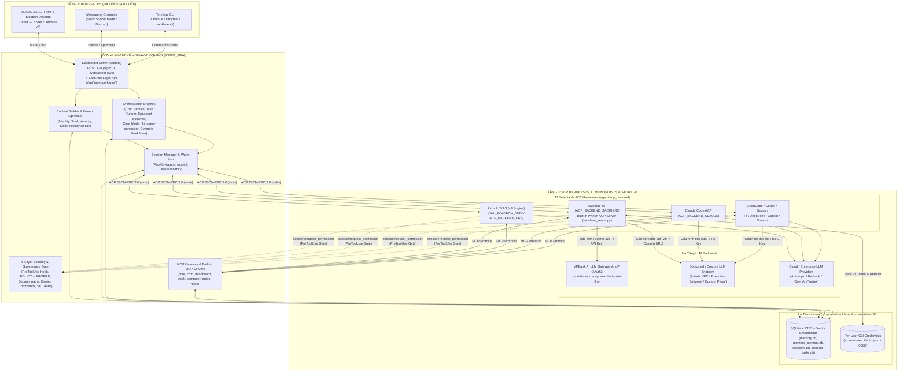
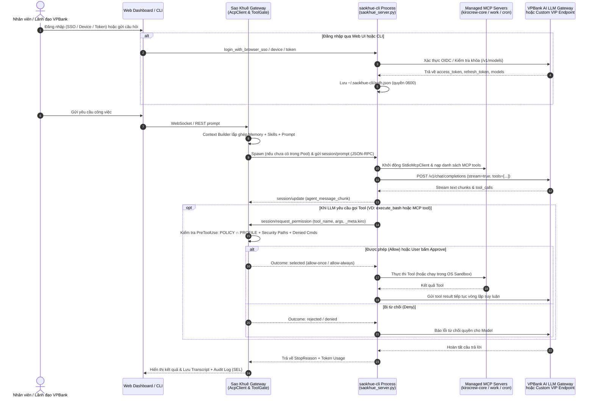
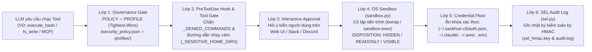
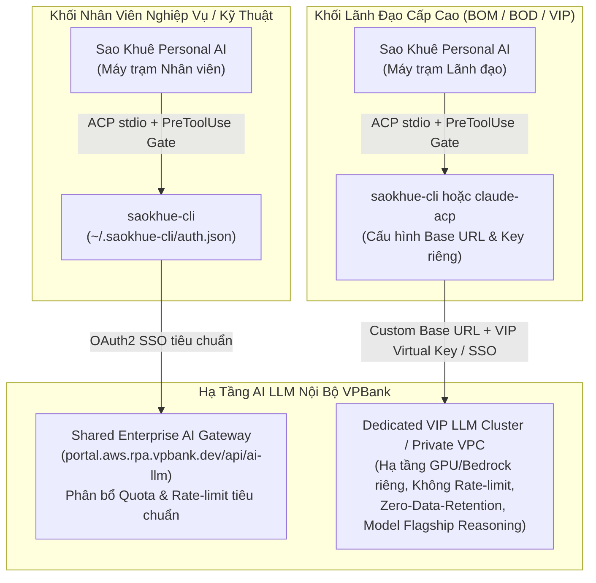

# Tài Liệu Kiến Trúc Hệ Thống Sao Khuê (VPBank Personal AI Agent Platform)

Tài liệu này mô tả kiến trúc tổng thể của **Sao Khuê** (`saokhue` / `kirocrew`) — nền tảng Trợ lý AI Cá nhân Tự hành (Autonomous Personal AI Agent) dành cho cán bộ nhân viên và lãnh đạo VPBank, kết hợp với kiến trúc nền tảng tại [overview.md](overview.md) và máy chủ ACP tích hợp **`saokhue-cli`** (`ACP_BACKEND_SAOKHUE = "saokhue"`).

---

## 1. Tổng Quan Hệ Thống Sao Khuê & Điểm Khác Biệt Cốt Lõi

**Sao Khuê** hoạt động như một lớp điều phối trung tâm (Gateway Daemon), kết nối người dùng từ đa kênh giao tiếp (Web Dashboard SPA, Desktop App Electron, CLI, Slack, Discord) tới các **ACP CLI Harness** thông qua giao thức chuẩn **ACP (Agent Client Protocol - JSON-RPC 2.0 qua stdio)**.

### 1.1. Ba trụ cột định danh của Sao Khuê
1. **Thư mục dữ liệu gốc (Data Home):** Mặc định lưu tại `~/.vpbank/saokhue` (`KIRO_BASE_DIR_NAME = ".vpbank"`, `CONFIG_DIR_LEAF = "saokhue"` trong `src/kiro_crew/config/paths.py`), có thể ghi đè qua biến môi trường `KIROCREW_HOME`. Ngoài ra hệ thống đặt một file chỉ dẫn khôi phục `~/.kirocrew.breadcrumb` nằm ngoài thư mục dữ liệu để tránh mất dấu khi cài đặt lại.
2. **Ba CLI Entrypoints chính thức (`pyproject.toml`):**
   - `saokhue` và `kirocrew` (`src/kiro_crew/_bootstrap.py`): Khởi chạy Gateway Daemon, Web Dashboard, CLI quản trị hệ thống và các MCP Server nội bộ.
   - `saokhue-cli` (`src/kiro_crew/acp/saokhue_server.py`): Built-in ACP v1 Server tích hợp sẵn trong gói Python của Sao Khuê, giao tiếp trực tiếp với cổng AI LLM Gateway nội bộ của VPBank (`https://portal.aws.rpa.vpbank.dev/api/ai-llm`) hoặc bất kỳ cổng OpenAI-compatible nào mà không cần cài thêm binary bên ngoài.
3. **Hệ sinh thái 15+ Managed Agent Specs (`saokhue-*`):** Định nghĩa tại `src/kiro_crew/agent_files.py`, tự động sinh và đồng bộ (materialize) ra đĩa gồm:
   - Agent chính: `kirocrew.json`
   - Các Conductor điều phối: `kirocrew-conductor.json`, `kirocrew-ledger-conductor.json`, `kirocrew-pipeline-conductor.json`, `kirocrew-security-conductor.json`
   - Các Worker & Chuyên gia: `kirocrew-worker.json`, `kirocrew-research.json`, `kirocrew-team-lead.json`, `kirocrew-knowledge.json`, `kirocrew-dashboard-author.json`, `kirocrew-dashboard-manager.json`
   - Các Agent dịch vụ & bảo mật: `kirocrew-lite.json` (tác vụ nền: đặt tiêu đề, nén ngữ cảnh), `kirocrew-heartbeat.json` (kiểm tra nhịp tim định kỳ), `kirocrew-guest.json` (agent không có quyền gọi tool dành cho người gửi không phải chủ sở hữu trên kênh chat)
   - Các Crewmate Service Agents (lưu tại `~/.vpbank/mates/agents/`): `kirocrew-mate-conductor.json`, `kirocrew-mate-worker.json`

### 1.2. So sánh: Chỉ dùng CLI đơn lẻ vs. Kết hợp cùng Sao Khuê Gateway

| Năng lực (Capability) | Chỉ dùng CLI đơn lẻ (`saokhue-cli` / `kiro-cli` / `claude`) | Khi có thêm Sao Khuê Gateway (`saokhue`) |
|---|---|---|
| **Giao diện sử dụng** | Chỉ có cửa sổ Terminal (CLI) | **Web Dashboard** (React SPA + Electron Desktop), **Slack**, **Discord**, **CLI**, và **REST/WebSocket API** |
| **Xác thực & Quản lý Model** | Cấu hình qua dòng lệnh hoặc file cấu hình rời rạc | Tích hợp trực tiếp thẻ đăng nhập **Sao Khuê Sign-In Card** (`SaoKhueSignInCard.tsx`) trên giao diện Web hỗ trợ 4 phương thức (Browser SSO PKCE, Device Code, Token/Virtual Key, Password) và chọn model trực quan |
| **Bộ nhớ dài hạn (Memory)** | Mất ngữ cảnh khi đóng phiên; phải tự quản lý file thủ công | **Hybrid Search** (FTS5 BM25 + Vector Cosine qua `llama-cpp-python` chạy in-process) + **History Decay** (tự động tóm tắt/nén lịch sử cũ) + **Auto-Consolidation** + **Lesson Extraction** |
| **Chạy tự động & Lập lịch** | Chỉ chạy khi người dùng ngồi gõ lệnh trực tiếp | **Cron Service** (cron, interval, one-shot), chạy Python script đã kiểm duyệt (`_vet_script_contents`) hoặc đánh thức Agent tự hành theo lịch |
| **Đa luồng & Đa tác tử (Multi-Agent)** | Một phiên làm việc tại một thời điểm | **Session Pool** (`PoolKey(agent, model)`), **Subagent Spawner** (chạy song song có Git worktree riêng), **Task Runner** (tác vụ nhiều bước có checkpoint), và **Crew Mode** (`kirocrew-conductor` + `kirocrew-worker` + Crewmates) |
| **Tích hợp kênh chat doanh nghiệp** | Không có | Kết nối hai chiều qua **Slack** (Socket Mode) và **Discord** với luồng **Interactive Approval** (phê duyệt quyền chạy lệnh ngay trên tin nhắn) |
| **Học kỹ năng động (Skills & Learn)** | Cấu hình tĩnh | **Self-Learning Engine** tự động tạo/cập nhật `SKILL.md`, cài đặt từ kho kỹ năng, hot-reload vào ngữ cảnh phiên chat |
| **Điều khiển máy tính (Computer Use)** | Chỉ thao tác qua dòng lệnh và file | Chụp màn hình, OCR, điều khiển chuột/phím đa màn hình (`@kirocrew-computer`) kèm **Safety Overlay** và phím tắt khẩn cấp (`Cmd+Shift+Escape`) |
| **Kiểm soát Bảo mật & Governance** | Phụ thuộc hoàn toàn vào cấu hình cục bộ của CLI | **Chốt chặn `PreToolUse` độc lập của Sao Khuê**: Giao thoa chính sách `POLICY ∩ PROFILE` (tightest-wins), OS Sandbox (`bwrap`/`sandbox-exec`), chống rò rỉ khóa xác thực, và nhật ký kiểm toán chống giả mạo **SEL (`sel_hmac.key`)** |

---

## 2. Kiến Trúc Tổng Thể 3 Tầng & Bản Đồ Thành Phần (Component Map)

Kiến trúc tổng thể của Sao Khuê được chia thành 3 tầng: **Interfaces (Giao diện) → Sao Khuê Gateway (Lõi điều phối) → Agent Runtime & Storage (Thực thi & Lưu trữ)**.



### 2.1. Bản đồ các phân hệ Backend (`src/kiro_crew/`)

| Phân hệ (Subsystem) | File / Thư mục chính | Vai trò kiến trúc |
|---|---|---|
| **ACP Client & Transport** | `acp/` (`client.py`, `client_start.py`, `session_provider.py`, `types.py`) | Quản lý kết nối JSON-RPC 2.0 qua stdio tới tiến trình ACP, khởi tạo phiên, truyền nhận streaming chunk (`session/update`), xử lý yêu cầu cấp quyền (`session/request_permission`) và tự phục hồi khi tiến trình con gặp sự cố. |
| **Built-in Sao Khuê CLI Server** | `acp/saokhue_server.py` (facade: lớp `SaokhueAcpServer` và `main`), các module chủ trong `saokhue_cli/` (`base` hằng số và thư mục người dùng, `tls` tin cậy chứng chỉ, `auth` đăng nhập, `mcp_client`, `turns` một lượt gọi mô hình, `cli` lệnh terminal), `acp/harness/saokhue.py`. Các module chủ nằm ngoài gói `acp` để khi chạy dạng script, server không nạp client và runtime của gói đó; mọi tên vẫn được truy cập và patch qua `kiro_crew.acp.saokhue_server` nhờ `_facade_mirror`. | Máy chủ ACP v1 tích hợp sẵn (`saokhue-cli`), kết nối tới cổng AI LLM của VPBank hoặc cổng OpenAI-compatible, tích hợp OIDC/OAuth2 SSO, tự động nạp CA Bundle của hệ điều hành, thực thi bộ công cụ workspace nội bộ và đóng vai trò MCP Client (`StdioMcpClient`). |
| **Agent SDK & Capability Registry** | `agent_sdk/` (`backends.py`, `backends_*.py`, `host_auth.py`, `tool_gate.py`, `backend_install.py`) | Định nghĩa 11 ACP backend (`ACP_BACKENDS_KNOWN`), ma trận năng lực (`ACP_BACKENDS_*`), cơ chế định tuyến quyền (`Routing`), kiểm tra cài đặt (`backend_install.py`), khai báo khóa xác thực (`host_auth.py`) và cổng kiểm duyệt công cụ (`tool_gate.py`). |
| **Agent Spec Materialization** | `agent.py`, `agent_files.py`, `agent_materialization/` | Sinh và đồng bộ hơn 15 file cấu hình agent (`kirocrew.json`, `kirocrew-conductor.json`, `kirocrew-worker.json`, `kirocrew-lite.json`, `kirocrew-guest.json`,...) kèm quy tắc `allowedTools`, `excludedTools` và `mcpServers`. |
| **Session & Runtime Ownership** | `session.py`, `session_parts/`, `runtime_ownership.py` | Quản lý vòng đời phiên chat, Warm Session Pool (`PoolKey(agent, model)`), theo dõi PID tiến trình con, cơ chế thuê bao (lease/tenancy) và thu dọn tiến trình mồ côi. |
| **Context Assembly & History** | `context.py`, `context_assembly/`, `history.py` | Lắp ghép ngữ cảnh gửi vào LLM theo ngân sách ký tự (Identity, Soul, Memory, Skills, History Summary) và quản lý lịch sử hội thoại kèm cơ chế phân rã ngữ cảnh cũ (History Decay). |
| **Memory & Knowledge** | `memory.py`, `member_memory.py`, `embeddings.py`, `knowledge/` | Bộ nhớ dài hạn V1 (Global) và V2 (theo từng thành viên - Member Scoped), kết hợp tìm kiếm từ khóa SQLite FTS5 (BM25) và tìm kiếm ngữ nghĩa Vector (`EmbeddingGemma-300M` chạy nội bộ qua `llama_cpp`). |
| **Security, Governance & Sandbox** | `security.py`, `security_parts/`, `hooks.py`, `sandbox.py`, `governance/`, `sel.py` | Thực thi 6 lớp bảo mật: chặn đường dẫn nhạy cảm (`_SENSITIVE_HOME_DIRS`), chặn lệnh nguy hiểm (`_DENIED_COMMANDS`), giao thoa chính sách `POLICY ∩ PROFILE`, cô lập OS Sandbox (`bwrap`/`sandbox-exec`) và ghi log kiểm toán SEL có chữ ký HMAC. |
| **Dashboard Server & Handlers** | `dashboard/` (`server.py`, `routes/`, `handlers/`, `handlers/saokhue_login.py`) | Máy chủ `aiohttp` phục vụ SPA, REST API, WebSocket thời gian thực, luồng đăng nhập `saokhue-cli` trực tiếp từ giao diện Web (`saokhue_login.py`), quản lý phiên và phê duyệt công cụ. |
| **Orchestration (Cron, Task, Subagent, Workflows)** | `cron.py`, `task.py`, `subagent.py`, `workflows/` | Điều phối tác vụ định kỳ, tác vụ nhiều bước có khả năng phục hồi khi gián đoạn, khởi chạy Subagent song song trên nhánh Git riêng và chạy quy trình động (DAG Workflows). |
| **MCP Servers & Gateway** | `mcp_*.py`, `mcp_tools/`, `mcp_gateway/` | Cung cấp các MCP Server nội bộ (`kirocrew-core`, `kirocrew-cron`, `kirocrew-dashboard`, `kirocrew-work`, `kirocrew-computer`, `kirocrew-guide`, `kirocrew-mate`) tuân thủ nguyên tắc *Stateless & SQLite-backed*. |
| **Platform Context & Enterprise Seam** | `platform/` (`context.py`, `contracts.py`, `standalone.py`) | Điểm ghép nối kiến trúc (CPP Seam) cho phép nạp gói mở rộng doanh nghiệp qua `entry_points(group="kiro_crew.platform")` và khóa cứng bằng `seal_context()`. |

### 2.2. Bản đồ Frontend (`website/src/` & `website/electron/`)

Frontend là ứng dụng React 19 + TypeScript + Vite + Tailwind CSS v4 (kèm ứng dụng Desktop Electron tại `website/electron/`), bao gồm các phân khu chính:
- **Chat & Crew Mode (`pages/chat/`):** Giao diện hội thoại thời gian thực qua WebSocket, hiển thị quá trình suy luận (thinking), lời gọi công cụ (tool calls), hộp thoại phê duyệt quyền (`ToolApprovalCard`), bảng điều khiển Crew Mode (`UltraCrewPanel`, `CrewLogPanel`) và bảng công việc của `kirocrew-conductor`.
- **Developer & Agent Harness (`pages/developer/`):** Quản lý lựa chọn ACP Backend (`AgentBackendTab.tsx`), đặc biệt tích hợp thẻ đăng nhập trực tiếp **`SaoKhueSignInCard.tsx`** kết nối với client API `website/src/api/saokhueLogin.ts` cho phép đăng nhập SSO/Device Code/Token/Password và chọn model ngay trên trình duyệt.
- **Overview, Tasks, Cron, Memory, Skills, Connections, Settings:** Các trang quản trị toàn diện vòng đời tác nhân, lịch chạy tự động, bộ nhớ, kỹ năng và cấu hình bảo mật.

---

## 3. Phân Tích Chuyên Sâu `saokhue-cli` & Hệ Sinh Thái 11 ACP CLI Harnesses

### 3.1. Kiến trúc nội tại của `saokhue-cli` (`ACP_BACKEND_SAOKHUE = "saokhue"`)

`saokhue-cli` là ACP Backend nội bộ được thiết kế chuyên biệt cho môi trường doanh nghiệp VPBank:
- **Định danh & Khởi chạy:**
  - Hằng số định danh: `ACP_BACKEND_SAOKHUE = "saokhue"` tại `src/kiro_crew/agent_sdk/backends.py`.
  - Bộ điều hợp tiến trình: `SaokhueLaunch` (`src/kiro_crew/acp/harness/saokhue.py`) kế thừa `ProcessAdapter`, khởi chạy lệnh `sys.executable -m kiro_crew.acp.saokhue_server acp [--agent <name>] [--model <id>]` qua ống dẫn `stdio`.
  - Không yêu cầu cài đặt công cụ bên ngoài: Hàm `_probe_saokhue()` (`src/kiro_crew/agent_sdk/backend_install.py`) luôn trả về trạng thái `INSTALLED` vì `saokhue-cli` nằm sẵn trong gói Python của Sao Khuê.
- **Kết nối mặc định tới Hạ tầng AI & IdP của VPBank (`src/kiro_crew/acp/saokhue_server.py`):**
  - `DEFAULT_SAOKHUE_BASE_URL = "https://portal.aws.rpa.vpbank.dev/api/ai-llm"`
  - `DEFAULT_OIDC_AUTHORIZE_URL = "https://portal.aws.rpa.vpbank.dev/api/idpOAuth/authorize"`
  - `DEFAULT_OIDC_DEVICE_AUTH_URL = "https://portal.aws.rpa.vpbank.dev/api/idpOAuth/device/auth"`
  - `DEFAULT_OIDC_TOKEN_URL = "https://portal.aws.rpa.vpbank.dev/api/idpOAuth/token"`
  - `DEFAULT_OIDC_USERINFO_URL = "https://portal.aws.rpa.vpbank.dev/api/idpOAuth/me"`
  - `DEFAULT_OIDC_REVOKE_URL = "https://portal.aws.rpa.vpbank.dev/api/idpOAuth/revoke"`
  - `DEFAULT_OIDC_CLIENT_ID = "app:test-crew"`, `DEFAULT_OIDC_SCOPE = "openid offline_access profile email api"`
- **Tự động giải quyết bài toán Chứng chỉ số Doanh nghiệp (Enterprise SSL/TLS Trust Store):**
  - Trong môi trường ngân hàng có cổng kiểm soát SSL/TLS hoặc Root CA nội bộ, hàm `ensure_system_ca_bundle()` tự động trích xuất chứng chỉ CA từ hệ điều hành (Windows Certificate Store `ROOT`/`CA` qua `ssl.enum_certificates`, macOS Keychain `/Library/Keychains/System.keychain`, hoặc Linux `/etc/ssl/certs`) kết hợp với `certifi` để kết xuất ra `~/.saokhue-cli/system-ca-bundle.pem`. Nhờ đó `saokhue-cli` hoạt động trơn tru trong mạng nội bộ VPBank mà không cần tắt kiểm tra SSL.
  - Mọi yêu cầu (`urllib` và `aiohttp`) đều kiểm tra chứng chỉ theo bundle này. Khi chứng chỉ không được tin cậy, yêu cầu thất bại với một cảnh báo nêu tên host; không có lần thử lại nào bỏ qua kiểm tra, vì yêu cầu mang token đăng nhập và nội dung hội thoại. Chỉ biến môi trường `SAOKHUE_SSL_VERIFY=0` do người vận hành đặt mới tắt kiểm tra.
  - Gateway cũng xuất bundle này cho mọi tiến trình con mỗi lần khởi động, kể cả khi proxy công ty tắt (`ca_bundle_env.export_for_children`): `NODE_EXTRA_CA_CERTS` trên mọi nền tảng, thêm `SSL_CERT_FILE`, `REQUESTS_CA_BUNDLE`, `AWS_CA_BUNDLE` trên Windows. Biến đã có giá trị thì giữ nguyên. Hàm xuất bundle không đọc macOS Keychain, nên trên macOS bundle chỉ gồm `certifi` và file CA mặc định của OpenSSL.
- **Proxy công ty:** các yêu cầu `aiohttp` (`/v1/models`, `/v1/chat/completions`) chọn proxy qua `http_proxy.resolve_proxy`, giống các yêu cầu `urllib`: `HTTPS_PROXY`/`NO_PROXY` của tiến trình (địa chỉ loopback của `auth_proxy` khi `network.proxy_enabled` bật), sau đó là proxy của hệ điều hành.
- **Stop (`session/cancel`):** lượt đang chạy bị hủy ngay. Lệnh `execute_bash` đang chạy bị kết thúc cùng toàn bộ cây tiến trình con (`platform_compat.kill_and_reap`). Lời gọi tool nào chưa có kết quả được ghi kết quả "đã hủy" (`close_unanswered_tool_calls`), vì Chat Completions từ chối một transcript có `tool_calls` thiếu tin nhắn `tool`. Đầu mỗi lượt cũng sửa như vậy, nên transcript đã lưu hỏng từ trước vẫn dùng tiếp được.
- **Chọn model:** khi endpoint có trả danh sách model, một lựa chọn không có trong danh sách bị từ chối bằng lỗi `-32602` (`Invalid value for config option model`). Client ACP coi đó là giá trị bị từ chối: lựa chọn được hoàn tác và lý do hiện cho người dùng, chứ không lặng lẽ chạy một model khác. Khi một lượt gặp lỗi, server chỉ thử model kế tiếp nếu lỗi nói rằng model không phục vụ được (HTTP 404, hoặc 400/422 nhắc tới model). Lỗi khác (transcript bị từ chối, lỗi mạng, timeout) được báo ngay, và `session.model` chỉ đổi khi một model thay thế trả lời thành công.
- **Danh sách model trong ô chọn model của chat:** ô chọn đọc danh sách mà một phiên Sao Khuê quảng bá (`availableModels`), lưu lại cho các lần sau trong bộ nhớ đệm `provider_models.json` (namespace `saokhue`). Khi endpoint không trả danh sách (chưa đăng nhập, không kết nối được) phiên không quảng bá model nào, kể cả tên giữ chỗ `saokhue-default`, nên ô chọn chỉ còn Auto. Mỗi lần thẻ đăng nhập đọc hoặc cập nhật trạng thái khi đã đăng nhập (`saokhue_login._status`), danh sách `/v1/models` của tài khoản được ghi vào bộ nhớ đệm đó và gửi sự kiện `models_changed`, nên ô chọn có danh sách ngay sau khi đăng nhập mà không phải đợi một phiên chat mới.
- **4 Phương thức xác thực linh hoạt (qua CLI `saokhue-cli login` hoặc Web UI `SaoKhueSignInCard.tsx`):**
  1. **Browser SSO (`sso` - Mặc định):** Luồng OAuth2 Authorization Code + PKCE mở trình duyệt xác thực qua cổng SSO VPBank và nhận callback tại `http://127.0.0.1:<port>/oauth/callback`, tự động làm mới token (`refresh_access_token`) khi hết hạn.
  2. **Device Code (`device`):** Luồng OAuth2 Device Authorization dành cho máy chủ headless/SSH hoặc khi trình duyệt nằm trên thiết bị khác.
  3. **Personal Access Token / Virtual Key (`token`):** Nhập trực tiếp khóa API / Virtual Key (tự động kiểm tra tính hợp lệ và lấy danh sách model qua `/v1/models` và `/key/info`).
  4. **Username & Password (`password`):** Đăng nhập qua endpoint xác thực mật khẩu của cổng AI Gateway.
- **Đầy đủ năng lực thực thi Tool & MCP Client:**
  - `SaokhueAcpServer` cung cấp sẵn 7 công cụ thao tác workspace nội bộ (`fs_read`, `fs_write`, `edit_file`, `list_directory`, `glob`, `grep`, `execute_bash`) VÀ khởi chạy `StdioMcpClient` để kết nối trực tiếp tới toàn bộ các MCP Server trong spec của Agent (`kirocrew-core`, `kirocrew-cron`, `kirocrew-dashboard`, `kirocrew-work`, `kirocrew-mate`,...).
  - Trước mỗi lần chạy bất kỳ công cụ nào (dù là built-in tool hay MCP tool), `SaokhueAcpServer` đều gửi bản tin `session/request_permission` kèm định danh `_meta.kiro` về cho Sao Khuê Gateway để kiểm duyệt qua cổng bảo mật `PreToolUse`.



### 3.2. Bảng tổng hợp 11 ACP CLI Harnesses trong Sao Khuê

Sao Khuê tuân thủ nguyên tắc **Harness Parity** (`src/kiro_crew/agent_sdk/backends.py`): định danh tường minh từng Backend cùng cơ chế kiểm soát quyền (`Routing`):

| STT | Mã Backend (`agent.acp_backend`) | Công cụ CLI / Server thực thi | Cơ chế Kiểm soát Quyền (`Routing`) | Nguồn Xác thực & Lưu trữ (`host_auth.py`) | Hỗ trợ Crew Mode & Mate Capabilities |
|---|---|---|---|---|---|
| 1 | **`"saokhue"`** (`ACP_BACKEND_SAOKHUE`) | Built-in **`saokhue-cli`** (`python -m kiro_crew.acp.saokhue_server acp`) | `Routing.AGENT_SPEC` (đọc spec agent + hỏi quyền qua `session/request_permission`) | `~/.saokhue-cli/auth.json` (hoặc `$SAOKHUE_CLI_HOME/auth.json`) + `.env` | **Đầy đủ** (Dispatch, Panel, Tool Limits, Mate Worker Kit) |
| 2 | **`"kas"`** (`ACP_BACKEND_KAS` - Mặc định khi trống) | `kiro-cli-chat acp` (Kiro v3 KAS Engine) | `Routing.AGENT_SPEC` (Project spec sang `~/.kiro/kas-agents/`) | Kiro CLI Auth (`~/.kiro/` / SQLite auth) | **Đầy đủ** |
| 3 | **`"kiro"`** (`ACP_BACKEND_KIRO = ""`) | `kiro-cli acp` (v2 hoặc tự nâng lên KAS v3 nếu hỗ trợ) | `Routing.AGENT_SPEC` (`~/.kiro/agents/<agent>.json`) | Kiro CLI Auth | **Đầy đủ** |
| 4 | **`"claude"`** (`ACP_BACKEND_CLAUDE`) | `claude-agent-acp` (`@agentclientprotocol/claude-agent-acp` bọc `claude`) | `Routing.PERMISSION_CALLBACK` (`canUseTool` → `session/request_permission`) | `~/.claude/.credentials.json` hoặc `$CLAUDE_CONFIG_DIR` | **Đầy đủ** |
| 5 | **`"opencode"`** (`ACP_BACKEND_OPENCODE`) | `opencode acp` | `Routing.CLIENT_META` (`OPENCODE_CONFIG_CONTENT={"permission":"ask"}`) | `~/.local/share/opencode/auth.json` | **Đầy đủ** |
| 6 | **`"codex"`** (`ACP_BACKEND_CODEX`) | `codex-acp` (`@zed-industries/codex-acp`) | `Routing.SESSION_CONFIG` (`approval_policy="on-request"`) | `~/.codex/auth.json` hoặc `$CODEX_HOME/auth.json` | **Đầy đủ** |
| 7 | **`"goose"`** (`ACP_BACKEND_GOOSE`) | `goose acp` | `Routing.SETTING_FILE` (`GOOSE_MODE: "approve"`) | `~/.config/goose/secrets.yaml` (hoặc OS Keychain) | Cơ bản |
| 8 | **`"pi"`** (`ACP_BACKEND_PI`) | `pi-acp` (bọc `@mariozechner/pi-coding-agent`) | `Routing.VERIFIED_GATE_EXTENSION` (nạp `pi_permission_gate.js`) | `~/.pi/agent/auth.json` | Cơ bản |
| 9 | **`"deepseek"`** (`ACP_BACKEND_DEEPSEEK`) | `dsh --profile acp` (DeepSeek Harness) | `Routing.VERIFIED_GATE_EXTENSION` (hook `before_tool_call`) | `~/.deepseek-harness/config.json` | Cơ bản |
| 10 | **`"copilot"`** (`ACP_BACKEND_COPILOT`) | `copilot --acp --stdio` (GitHub Copilot CLI) | `Routing.SESSION_CONFIG` (giữ `allow_all` tắt) | `~/.copilot/config.json` | Cơ bản |
| 11 | **`"strands"`** (`ACP_BACKEND_STRANDS`) | `strands --agent <project> --acp-server` | `Routing.VERIFIED_GATE_EXTENSION` (`strands_gated_agent.py`) | AWS Bedrock / Provider Env trong `~/.vpbank/saokhue/.env` | Cơ bản |

---

## 4. Vòng Đời Phiên (Session Lifecycle), Bộ Nhớ (Memory) & Bảo Mật 6 Lớp

### 4.1. Vòng đời Phiên làm việc (Warm Session Pool, Timeouts & 7-Step Shutdown)

Theo [overview.md](overview.md) và `src/kiro_crew/session.py`:
1. **Warm Session Pool (`PoolKey(agent, model)`):** Thay vì phải tốn 3–5 giây khởi tạo lại tiến trình CLI cho mỗi tin nhắn, `SessionManager` duy trì một bể chứa các tiến trình ACP đã khởi động sẵn theo cặp khóa `(agent, model)` (quy mô mặc định `pool_size` trên mỗi khóa, tổng tối đa `_MAX_TOTAL_WARM = 6`). Khi có phiên mới, hệ thống lấy ngay tiến trình ấm từ Pool và đồng thời bổ sung tiến trình mới ở nền.
2. **Các ngưỡng Timeout bảo vệ tài nguyên:**
   - **Startup Timeout (`120s`):** Thời gian tối đa để tiến trình ACP khởi động, hoàn tất bắt tay `initialize` và `session/new` (kể cả khởi tạo các MCP server).
   - **Prompt Inactivity Timeout (`prompt_timeout = 300s`):** Đây là **bộ đếm không hoạt động (inactivity timer)**, không phải giới hạn tổng thời gian chạy. Mỗi khi tiến trình ACP gửi về một chunk văn bản, một sự kiện gọi tool hay yêu cầu cấp quyền, bộ đếm 300 giây đều được đặt lại từ đầu. Nhờ đó các tác vụ phức tạp kéo dài hàng giờ vẫn chạy liên tục miễn là Agent còn phản hồi.
   - **Idle Eviction (`session_idle_ttl = 1800s` / 30 phút):** Tự động thu hồi các tiến trình ACP nhàn rỗi quá 30 phút (trừ các phiên đang có tác vụ nền hoạt động) để giải phóng RAM; khi người dùng nhắn lại, lịch sử hội thoại được khôi phục tự động từ SQLite.
3. **Quy trình đóng hệ thống 7 bước an toàn (Graceful 7-Step Shutdown):**
   Khi dừng Gateway (`SIGTERM`/`SIGINT`), hệ thống tuần tự thực hiện: (1) Đánh dấu các Task đang chạy sang trạng thái `interrupted` kèm checkpoint để lần sau chạy tiếp; (2) Dừng các kênh nhận tin nhắn (Slack/Discord); (3) Dừng bộ lập lịch Cron; (4) Thu hồi toàn bộ Subagent đang chạy; (5) Hủy các tác vụ nền của Dashboard; (6) Đóng toàn bộ tiến trình ACP trong các phiên đang mở và trong Warm Pool (`SIGTERM` → `SIGKILL` qua `runtime_ownership.py`); (7) Đóng kết nối cơ sở dữ liệu SQLite.

### 4.2. Kiến trúc Bộ nhớ (Memory Lifecycle) & Ngữ cảnh (Context Assembly)

Hệ thống bộ nhớ của Sao Khuê hoạt động hoàn toàn cục bộ (không phụ thuộc dịch vụ Vector DB bên ngoài):
- **Hai tầng Bộ nhớ (Global V1 & Member-Scoped V2):**
  - **Global Memory (`memory.py` - `memory.db`):** Lưu trữ sự kiện, quyết định, sở thích và kiến thức chung của người vận hành.
  - **Member Memory (`member_memory.py` - `member_memory.db`):** Khi triển khai mô hình Shared Crew (nhiều người cùng tương tác qua kênh chat), mỗi thành viên có không gian bộ nhớ riêng biệt để không bị lẫn lộn thông tin cá nhân giữa các nhân viên.
- **Tìm kiếm Lai (Hybrid Search: BM25 + Vector Cosine):**
  - Kết hợp tìm kiếm từ khóa chính xác qua **SQLite FTS5 (BM25)** (trọng số `0.3`) và tìm kiếm tương đồng ngữ nghĩa qua **Vector Cosine Similarity** (trọng số `0.7`) sử dụng mô hình nhúng đa ngôn ngữ `EmbeddingGemma-300M` (`embeddinggemma-300M-Q8_0.gguf`) chạy trực tiếp trong tiến trình qua `llama-cpp-python`.
- **History Decay (Phân rã lịch sử thông minh):**
  - Các lượt hội thoại gần nhất được giữ nguyên văn (full fidelity); các lượt cũ hơn được tóm tắt phân tầng theo độ tuổi để giữ trọn ý chính mà không làm tràn cửa sổ ngữ cảnh (Context Window). Chi tiết xem tại [context-management.md](context-management.md).

### 4.3. Kiến trúc Bảo mật 6 Lớp (6-Layer Defense-in-Depth) & CPP Enterprise Seam

Chi tiết về mô hình bảo mật được mô tả tại [security-deep-dive.md](security-deep-dive.md):



1. **Lớp 1 — Keystone Governance (`POLICY ∩ PROFILE`, Tightest-Wins):** Các tệp `security_policy.json`, `profiles/`, `admission_policy.json` và `computer_use.json` trong `~/.vpbank/saokhue/` tạo thành trần quyền hạn tối đa (Governance Ceiling). Quyền thực tế luôn là phép giao chặt nhất giữa chính sách doanh nghiệp (`POLICY`) và hồ sơ phiên (`PROFILE`).
2. **Lớp 2 — OS Sandbox Dispositions (`sandbox.py`):** Cưỡng chế ở tầng hệ điều hành với 3 mức độ:
   - `HIDDEN`: Ẩn hoàn toàn bằng bind-mask trong mọi chế độ sandbox (bao gồm các thư mục chứa khóa xác thực, `.env`, `live_target.json`).
   - `READONLY`: Cho phép đọc nhưng khóa tuyệt đối quyền ghi để Agent không bao giờ tự nâng trần quyền của chính mình (`security_policy.json`, `profiles/`, `admission_policy.json`, `computer_use.json`).
   - `VISIBLE`: Cho phép đọc/ghi đối với dữ liệu làm việc thông thường, được kiểm soát qua cổng `PreToolUse`.
3. **Lớp 3 — Bảo vệ Khóa Xác thực của các CLI (`Credential Floor`):** Mọi tệp chứa token của các CLI (`~/.saokhue-cli/auth.json`, `~/.claude/.credentials.json`, `~/.codex/auth.json`, `~/.aws`, `~/.ssh`,...) đều nằm trong danh sách bảo vệ của `security.sensitive_home_dirs()` và `host_auth.py`. Bản thân tiến trình CLI vẫn đọc được khóa của chính nó để gọi LLM, nhưng nếu LLM sinh lệnh bash cố đọc trộm các tệp này (ví dụ `cat ~/.saokhue-cli/auth.json`), cổng `PreToolUse` sẽ lập tức chặn đứng.
4. **Lớp 4 — Kiểm toán chống giả mạo (`SEL - Security Event Log`):** Mọi sự kiện nhạy cảm (bao gồm cả các thao tác đăng nhập/đổi model trên `saokhue_login.py` và mọi lệnh thực thi) đều được ghi vào nhật ký kiểm toán kèm chữ ký HMAC (`sel_hmac.key`).
5. **Điểm ghép nối Quản trị Doanh nghiệp (`CPP Seam` - `src/kiro_crew/platform/`):** Cho phép bộ phận CNTT/An ninh thông tin của VPBank đóng gói một Python package nội bộ đăng ký qua `entry_points(group="kiro_crew.platform")` để áp đặt chính sách tập trung từ máy chủ quản trị mà không cần sửa đổi mã nguồn lõi. Ngay sau khi nạp lúc khởi động, `seal_context()` sẽ khóa cứng cấu hình này trong suốt vòng đời tiến trình.

---

## 5. Đánh Giá Kỹ Thuật: Người Dùng Cấu Hình CLI Độc Lập & Lãnh Đạo Cấp Cao (VIP) Sử Dụng LLM Endpoint Riêng

### 5.1. Câu hỏi đánh giá
> *"Người sử dụng có thể cấu hình CLI độc lập với Sao Khuê? Ví dụ lãnh đạo cấp cao có thể sử dụng các LLM endpoint được build riêng? Đánh giá xem điểm trên có đúng không?"*

### 5.2. Kết luận đánh giá
**KHẲNG ĐỊNH: HOÀN TOÀN ĐÚNG (CHÍNH XÁC 100% VỀ MẶT KIẾN TRÚC VÀ MÃ NGUỒN).**

Kiến trúc của Sao Khuê tách biệt hoàn toàn **Tầng Điều phối & Quản trị (Sao Khuê Gateway)** khỏi **Tầng Cấu hình Kết nối LLM của từng CLI Harness (`saokhue-cli`, `claude`, `opencode`, `codex`,...)**. Người dùng hoặc quản trị viên VIP có thể cấu hình CLI trỏ tới một LLM Endpoint riêng biệt (Dedicated/Private Endpoint) theo **3 cơ chế độc lập**, và Sao Khuê sẽ tôn trọng tuyệt đối cấu hình đó trong khi vẫn giữ nguyên mọi tính năng bảo mật, bộ nhớ và tự động hóa.

### 5.3. Bằng chứng kỹ thuật trực tiếp trong mã nguồn

#### Cơ chế 1: Cấu hình độc lập qua `saokhue-cli` (CLI hoặc giao diện Web `SaoKhueSignInCard`)
Trong `src/kiro_crew/acp/saokhue_server.py`, hàm `resolve_saokhue_settings()` phân giải địa chỉ máy chủ LLM (`base_url`), khóa xác thực (`access_token`) và model mặc định (`default_model`) từ hồ sơ cá nhân `~/.saokhue-cli/auth.json` và biến môi trường:
- Người dùng (hoặc thư ký/IT hỗ trợ lãnh đạo) có thể cấu hình `saokhue-cli` hoàn toàn độc lập từ cửa sổ dòng lệnh bên ngoài Sao Khuê:
  ```bash
  # Cách A: Đăng nhập SSO hoặc Device Code vào cổng LLM riêng dành cho Ban Lãnh Đạo
  saokhue-cli login --method sso --base-url https://vip-llm.vpbank.internal/api/ai-llm

  # Cách B: Cấu hình bằng Virtual Key / Personal Access Token vào cụm GPU/Endpoint riêng
  saokhue-cli login --method token --base-url https://executive-ai.vpbank.dev/v1 --token sk-vip-xxxx --model claude-3-7-sonnet-vip
  ```
- Hoặc cấu hình ngay trên giao diện **Settings → Agent Harness → Sao Khuê CLI** (`SaoKhueSignInCard.tsx`), nơi cho phép nhập tùy chỉnh **Base URL**, **SSO/Token URL**, **Client ID**, **Token/Virtual Key** và chọn **Model** từ danh sách mà Endpoint riêng đó cung cấp.
- Khi Sao Khuê Gateway khởi chạy phiên chat, `SaokhueAcpServer` tự động đọc `~/.saokhue-cli/auth.json` (hoặc biến môi trường `SAOKHUE_BASE_URL`, `SAOKHUE_PROXY_URL`, `SAOKHUE_ACCESS_TOKEN`, `SAOKHUE_MODEL` được `inject_saokhue_env()` truyền từ `~/.vpbank/saokhue/.env`) để gửi trực tiếp yêu cầu `/v1/chat/completions` tới Endpoint riêng đó.

#### Cơ chế 2: Cấu hình độc lập trên các CLI bên thứ ba (`claude`, `opencode`, `codex`, `goose`, `deepseek`, `strands`)
Theo `src/kiro_crew/agent_sdk/host_auth.py`, mỗi CLI Harness đều sở hữu không gian cấu hình độc lập (`ENTITLEMENT_OWN_CREDENTIAL_FILE`) và hàm `apply_child_env_defaults()` (`src/kiro_crew/acp/harness/_base.py`) của Sao Khuê chỉ sử dụng `env.setdefault(...)` — nghĩa là **không bao giờ ghi đè** các biến môi trường hoặc tệp cấu hình riêng mà người dùng đã thiết lập cho CLI:
- Với **`claude`** (`ACP_BACKEND_CLAUDE`): Có thể cấu hình `~/.claude/settings.json` hoặc biến môi trường `ANTHROPIC_BASE_URL` / `ANTHROPIC_BEDROCK_BASE_URL` trỏ tới cổng Anthropic/Bedrock riêng của lãnh đạo.
- Với **`opencode`** (`ACP_BACKEND_OPENCODE`) / **`codex`** (`ACP_BACKEND_CODEX`) / **`goose`** (`ACP_BACKEND_GOOSE`): Đọc trực tiếp tệp cấu hình `~/.config/opencode/opencode.json`, `~/.codex/config.toml`, `~/.config/goose/config.yaml` với provider và endpoint tùy chỉnh hoàn toàn độc lập với Sao Khuê.

#### Cơ chế 3: Phân tách luồng dữ liệu cho Lãnh đạo Cấp cao (VIP Executive Isolation)



- **Lợi ích cho Lãnh đạo Cấp cao (VIP):**
  1. **Độ trễ thấp & Không bị nghẽn (Dedicated Throughput):** Lãnh đạo kết nối vào cụm Endpoint riêng có băng thông ưu tiên (Provisioned Throughput), không bị ảnh hưởng khi hàng nghìn nhân viên cùng truy vấn giờ cao điểm.
  2. **Tiếp cận các mô hình suy luận cao cấp nhất (Flagship Reasoning Models):** Endpoint riêng có thể mở quyền truy cập các mô hình lớn nhất phục vụ phân tích chiến lược, báo cáo tài chính vĩ mô, thẩm định rủi ro tín dụng phức tạp.
  3. **Cô lập dữ liệu nhạy cảm cấp thượng tầng (Executive Data Isolation):** Toàn bộ nội dung hội thoại của lãnh đạo chỉ đi qua đường truyền riêng (Private VPC Endpoint) với chính sách *Zero Data Retention* trên tầng suy luận, đồng thời lịch sử và bộ nhớ (`memory.db`) nằm hoàn toàn trên máy cá nhân của lãnh đạo (`~/.vpbank/saokhue/`) dưới sự bảo vệ của 6 lớp bảo mật Sao Khuê.

---

## 6. Lợi Ích Chiến Lược Khi Triển Khai Sao Khuê Làm Công Cụ Personal AI Cho Nhân Viên VPBank

### 6.1. An toàn thông tin & Tuân thủ chuẩn mực Ngân hàng (Bank-Grade Security & Compliance)
- **Không rò rỉ dữ liệu ra đám mây công cộng trái phép:** Kết nối mặc định qua `saokhue-cli` đi thẳng vào cổng **VPBank AI LLM Gateway** (`portal.aws.rpa.vpbank.dev/api/ai-llm`) xác thực bằng SSO nội bộ (`idpOAuth`), đảm bảo dữ liệu ngân hàng không bị gửi lên các dịch vụ AI tiêu dùng bên ngoài.
- **Kiểm soát tập trung không thể vượt rào (`POLICY ∩ PROFILE`):** Nhờ cơ chế `PreToolUse` và OS Sandbox (`sandbox.py`), bộ phận An ninh thông tin (InfoSec) của VPBank có thể áp đặt chính sách chặn các lệnh nguy hiểm, bảo vệ thư mục nhạy cảm và ghi nhận đầy đủ nhật ký kiểm toán chống giả mạo (`SEL` với `sel_hmac.key`), đáp ứng yêu cầu kiểm toán nội bộ và quy định của Ngân hàng Nhà nước.

### 6.2. Tự động hóa công việc đa bước & Tác nhân đồng hành (`Crew Mode` & `kirocrew-conductor`)
- Nhân viên không chỉ "hỏi - đáp" đơn thuần như các chatbot thông thường, mà có một **Đội ngũ Trợ lý (Crew)** thực thụ:
  - **`kirocrew-conductor`** đóng vai trò nhạc trưởng phân rã mục tiêu lớn thành các đầu việc trên bảng **Work Ledger** (`kirocrew-work`) và giao cho các **`kirocrew-worker`** hoặc Crewmates thực thi song song.
  - **Cron Service & Dynamic Workflows:** Tự động tổng hợp báo cáo đầu ngày, theo dõi cảnh báo hệ thống, rà soát PR/code, hoặc xử lý dữ liệu định kỳ mà không cần con người can thiệp thủ công.

### 6.3. Cá nhân hóa sâu theo từng nhân viên & Tích lũy tri thức tổ chức (Memory & Self-Learning Skills)
- **Bộ nhớ dài hạn chạy nội bộ (Local Hybrid Memory):** Sao Khuê ghi nhớ ngữ cảnh dự án, quy trình làm việc và văn phong của từng nhân viên qua `memory.db` (sử dụng mô hình nhúng chạy ngay trên máy trạm mà không cần gửi dữ liệu đi nơi khác).
- **Chuẩn hóa và chia sẻ kỹ năng (`SKILL.md`):** Các quy trình nghiệp vụ chuẩn của VPBank (quy trình kiểm thử, chuẩn viết code, mẫu báo cáo phân tích tín dụng, quy trình vận hành RPA/AWS) có thể được đóng gói thành các bộ `SKILL.md` để mọi nhân viên tái sử dụng ngay lập tức.

### 6.4. Trải nghiệm đồng nhất từ Nhân viên Kỹ thuật đến Khối Nghiệp vụ (Unified Multi-Persona UX)
- **Khối Nghiệp vụ / Quản lý / Lãnh đạo:** Sử dụng giao diện **Web Dashboard / Desktop App** trực quan, đăng nhập 1 chạm qua thẻ **Sao Khuê Sign-In Card (SSO)**, làm việc qua bảng công việc trực quan, tạo tài liệu/biểu đồ qua **Artifacts & Companion Chat**, hoặc giao việc từ xa qua **Slack/Discord**.
- **Khối Công nghệ (Developers, DevOps, Data Engineers, QA):** Khai thác tối đa sức mạnh của `saokhue-cli`, `kiro-cli`, `claude` ngay trong Terminal, tự động hóa kiểm thử, phân tích log và quản lý nhánh Git worktree song song.

### 6.5. Chống phụ thuộc nhà cung cấp (Zero Vendor Lock-in) & Tối ưu chi phí
- Nhờ chuẩn hóa trên giao thức **ACP** và tích hợp sẵn **`saokhue-cli`**, VPBank có thể linh hoạt chuyển đổi hoặc kết hợp nhiều mô hình LLM (Claude, GPT, Gemini, DeepSeek, Qwen, hoặc các mô hình mã nguồn mở tự host nội bộ) phía sau cổng AI LLM Gateway mà không phải thay đổi giao diện hay đào tạo lại người dùng.
- Cơ chế **`agent.role_models`** (`src/kiro_crew/config/sections_agent_fields.py`) cho phép tự động định tuyến các tác vụ nền (`kirocrew-lite`, `kirocrew-heartbeat`) sang các mô hình nhỏ chi phí thấp, trong khi giữ các mô hình mạnh nhất cho phiên hội thoại chính và phân tích chuyên sâu.

---

## 7. Cấu Trúc Thư Mục Dữ Liệu Runtime Của Sao Khuê

Khi vận hành trên máy trạm của người dùng, dữ liệu của Sao Khuê được tổ chức tại 2 thư mục gốc:

```text
~/.vpbank/saokhue/                  # Data Home của Sao Khuê Gateway (hoặc $KIROCREW_HOME)
├── config.json                     # Cấu hình hệ thống (agent.acp_backend, model, channels, pool_size,...)
├── .env                            # Biến môi trường (SAOKHUE_BASE_URL, SAOKHUE_API_KEY,...) [HIDDEN trong Sandbox]
├── security_policy.json            # Trần chính sách bảo mật (Keystone Ceiling) [READONLY trong Sandbox]
├── admission_policy.json           # Chính sách cấp quyền người dùng [READONLY trong Sandbox]
├── computer_use.json               # Cấu hình bật/tắt điều khiển màn hình [READONLY trong Sandbox]
├── profiles/                       # Hồ sơ quyền theo phiên [READONLY trong Sandbox]
├── sel_hmac.key                    # Khóa ký HMAC cho nhật ký kiểm toán bảo mật SEL
├── audit.log                       # Nhật ký kiểm toán thực thi lệnh
├── memory.db                       # SQLite + FTS5 + Vector Embeddings (Bộ nhớ toàn cục V1)
├── member_memory.db                # Bộ nhớ phân tách theo từng thành viên (V2)
├── sessions.db                     # Metadata phiên làm việc & lịch sử hội thoại
├── saokhue_sessions/               # Transcript chi tiết các phiên của saokhue-cli (<session_id>.json)
├── cron.db & tasks.db              # Cơ sở dữ liệu lập lịch Cron và Task Runner
└── skills/                         # Các kỹ năng (SKILL.md) tự học hoặc cài đặt thêm

~/.saokhue-cli/                     # Thư mục cấu hình độc lập của saokhue-cli (hoặc $SAOKHUE_CLI_HOME)
├── auth.json                       # Thông tin đăng nhập OAuth2/SSO/Token & danh sách model (0600) [Credential Floor]
└── system-ca-bundle.pem            # Bó chứng chỉ CA tổng hợp từ OS Trust Store + certifi
```
