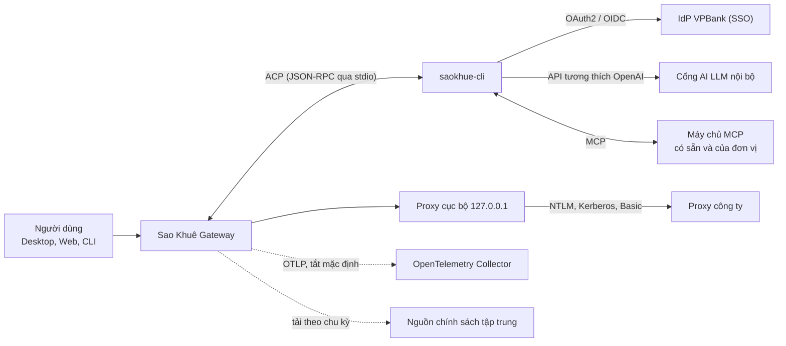

# Sao Khuê: tích hợp

Tài liệu dành cho kiến trúc sư và các đơn vị có hệ thống cần kết nối. Nội dung gồm
các điểm tích hợp giữa Sao Khuê và hạ tầng VPBank, cơ chế hoạt động của từng điểm và
quy trình đưa một hệ thống nội bộ vào nền tảng.

## 1. Nguyên tắc tích hợp

| Nguyên tắc | Áp dụng |
|---|---|
| Chuẩn mở cho từng chiều tích hợp | Mô hình AI qua API tương thích OpenAI; công cụ và dữ liệu qua MCP; danh tính qua OAuth2/OIDC; đo lường qua OpenTelemetry |
| Không sửa lõi khi thêm hệ thống | Hệ thống nội bộ được cung cấp dưới dạng máy chủ MCP và chịu cùng cổng kiểm soát quyền |
| Tương thích mạng ngân hàng | Proxy có xác thực và chứng chỉ CA nội bộ đã được xử lý trong bản dựng |

## 2. Sơ đồ tích hợp

## 3. Các điểm tích hợp

### 3.1. Danh tính

`saokhue-cli` xác thực với IdP qua OAuth2/OIDC theo bốn phương thức, lựa chọn trên
thẻ đăng nhập hoặc bằng lệnh `saokhue-cli login`.

| Phương thức | Trường hợp áp dụng |
|---|---|
| SSO qua trình duyệt (Authorization Code + PKCE) | Mặc định trên máy trạm |
| Mã thiết bị (Device Authorization) | Máy chủ không có trình duyệt, phiên SSH |
| Token hoặc virtual key | Tài khoản dịch vụ, endpoint riêng |
| Tên đăng nhập và mật khẩu | Cổng chỉ hỗ trợ xác thực mật khẩu |

Token lưu tại `~/.saokhue-cli/auth.json` với quyền đọc giới hạn cho chủ sở hữu và
được làm mới tự động. Chỉ chủ dashboard được thay đổi thông tin đăng nhập; mỗi thay
đổi được ghi nhật ký kiểm toán.

Địa chỉ OIDC, client ID và scope được cấu hình qua biến môi trường `SAOKHUE_OIDC_*`
và `SAOKHUE_CLIENT_ID`. Việc chuyển từ môi trường thử nghiệm sang sản xuất chỉ yêu
cầu thay đổi cấu hình.

### 3.2. Mô hình AI

`saokhue-cli` gọi `/v1/chat/completions` (streaming, tool calling) và lấy danh sách
mô hình từ `/v1/models`. Mọi cổng tương thích OpenAI đều sử dụng được.

| Cấu hình | Biến môi trường |
|---|---|
| Địa chỉ cổng | `SAOKHUE_BASE_URL` |
| Khóa | `SAOKHUE_ACCESS_TOKEN`, `SAOKHUE_API_KEY` |
| Mô hình mặc định | `SAOKHUE_MODEL` |
| Bắt buộc đăng nhập | `SAOKHUE_REQUIRE_LOGIN=1` |

Hàm ý đối với VPBank: việc lựa chọn mô hình, phân bổ hạn mức và hạch toán chi phí
được quản lý tập trung tại cổng. Từng nhóm người dùng có thể được cấu hình endpoint
riêng. Các tác vụ nền có thể sử dụng mô hình chi phí thấp hơn qua
`agent.role_models`.

### 3.3. Proxy công ty

Khi `network.proxy_enabled` được bật, Gateway khởi động một proxy trên `127.0.0.1` và
định tuyến chính nó cùng các tiến trình con qua proxy này. Proxy cục bộ xác thực với
proxy công ty theo một trong hai cách:

| Cách xác thực | Đặc điểm |
|---|---|
| Tài khoản Windows đang đăng nhập (NTLM hoặc Kerberos qua SSPI) | Không lưu tên đăng nhập và mật khẩu |
| Basic | Mật khẩu chỉ lưu trong kho bí mật; mật khẩu dạng văn bản thường bị từ chối khi lưu |

Tiến trình con chỉ nhận địa chỉ loopback và token dùng một lần. Thẻ Company proxy
tại Settings > Overview có chức năng kiểm tra kết nối.

Chưa hỗ trợ: đăng nhập bằng tài khoản Windows khác, NTLM hoặc Kerberos trên macOS và
Linux, tệp PAC, lệnh CLI chạy ở terminal riêng.

### 3.4. Chứng chỉ CA nội bộ

`saokhue-cli` kết hợp chứng chỉ từ kho của hệ điều hành với bộ CA chuẩn, cho phép kết
nối qua thiết bị kiểm tra TLS của Ngân hàng mà vẫn giữ kiểm tra chứng chỉ. Biến
`SAOKHUE_SSL_VERIFY=0` tắt kiểm tra này và cần bị cấm trong môi trường sản xuất.

### 3.5. Công cụ và dữ liệu qua MCP

- Nền tảng cung cấp sẵn máy chủ MCP cho bộ nhớ và tri thức, lập lịch, dashboard, sổ
  công việc và điều khiển máy tính.
- Chế độ registry MCP doanh nghiệp (`agent.mcp_registry_mode`) bật theo mặc định; chỉ
  máy chủ trong danh mục được duyệt mới được kết nối.
- Khung connector có sẵn cho GitHub, Microsoft Graph và Zoom.
- Mọi máy chủ MCP chịu cùng cổng kiểm soát quyền với công cụ tích hợp sẵn.

### 3.6. Chính sách tập trung

`security_policy.json` xác định trần quyền của mỗi máy. Khi được cấu hình nguồn tập
trung, máy tải chính sách lúc khởi động, lưu bản hợp lệ gần nhất và tải lại theo chu
kỳ. Thay đổi có hiệu lực trong phạm vi một chu kỳ. Chính sách cục bộ chỉ có thể siết
chặt thêm chính sách tập trung.

### 3.7. Đo lường

Đo lường tắt theo mặc định và gồm hai thiết lập độc lập. Bật thu thập chỉ ghi dữ liệu
ra tệp cục bộ. Gửi dữ liệu ra ngoài yêu cầu thêm địa chỉ collector và gói exporter
OTLP.

### 3.8. Kênh sử dụng và giao diện lập trình

- Ứng dụng desktop, web dashboard, dòng lệnh, REST API và WebSocket.
- Kênh nhắn tin (Slack, Discord) có trong nền tảng; việc kích hoạt thuộc thẩm quyền
  chính sách của VPBank.
- Bản Sao Khuê ẩn chức năng kết nối điện thoại.

### 3.9. Cơ chế mở rộng

| Cơ chế | Mục đích |
|---|---|
| Edition (`editions/saokhue/`) | Tùy biến giao diện qua điểm mở rộng của lõi |
| App Kit | Đơn vị đóng gói giao diện, agent, kỹ năng và lịch chạy thành ứng dụng phát hành từ kho riêng |
| Điểm ghép nền tảng (`platform/`) | Gắn gói quản trị doanh nghiệp |

## 4. Quy trình tích hợp hệ thống của đơn vị

1. Xác định các thao tác agent cần thực hiện trên hệ thống.
2. Cung cấp các thao tác dưới dạng máy chủ MCP không giữ trạng thái theo người gọi.
3. Đăng ký máy chủ vào registry MCP để quản trị viên phê duyệt.
4. Khai báo trong chính sách thao tác nào tự động, thao tác nào cần phê duyệt.
5. Soạn kỹ năng (`SKILL.md`) mô tả quy trình nghiệp vụ sử dụng các công cụ đó.

## 5. Hạng mục tích hợp cần hoàn tất

| Hạng mục | Hiện trạng | Yêu cầu |
|---|---|---|
| Địa chỉ cổng và IdP | Mặc định `portal.aws.rpa.vpbank.dev` | Cấp địa chỉ sản xuất |
| Client ID OIDC | `app:test-crew` | Đăng ký client chính thức |
| Nguồn chính sách tập trung | Cơ chế sẵn có | Thiết lập endpoint và quy trình phát hành chính sách |
| Danh mục registry MCP | Chế độ bật mặc định | Lập danh mục máy chủ được duyệt |
| Collector đo lường | Tắt mặc định | Quyết định phạm vi thu thập và nơi nhận |
