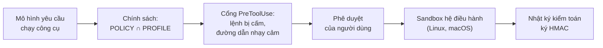

# Sao Khuê: bảo mật và quản trị

Tài liệu dành cho An ninh thông tin, Quản trị rủi ro và Kiểm toán nội bộ. Nội dung
gồm mô hình kiểm soát, vị trí lưu trữ dữ liệu, các giới hạn hiện tại và danh mục thẩm
định đề xuất. Chi tiết ở mức mã nguồn:
[security-deep-dive](../architecture/security-deep-dive.md).

## 1. Tóm tắt

| Nhận định | Cơ sở |
|---|---|
| Quyền kiểm soát thuộc VPBank | Cổng kiểm soát quyền do Sao Khuê thực thi, độc lập với cấu hình của bộ máy agent |
| Agent không tự nâng quyền | Tệp trần quyền ở chế độ chỉ đọc đối với agent |
| Quy tắc chặt nhất có hiệu lực | Quyền hiệu lực là phần giao của chính sách doanh nghiệp và hồ sơ phiên |
| Dữ liệu mặc định lưu tại máy | Lịch sử, bộ nhớ và tri thức lưu trong SQLite cục bộ; đo lường tắt |
| Tồn tại giới hạn cần biện pháp bù | Windows chưa có sandbox tầng hệ điều hành (mục 5) |

## 2. Vị trí lưu trữ dữ liệu

| Dữ liệu | Vị trí | Ghi chú |
|---|---|---|
| Lịch sử hội thoại, phiên | `~/.vpbank/saokhue/` (SQLite) | Máy người dùng |
| Bộ nhớ dài hạn, tri thức | `~/.vpbank/saokhue/` (SQLite, FTS5, vector) | Mô hình nhúng chạy cục bộ |
| Token đăng nhập `saokhue-cli` | `~/.saokhue-cli/auth.json` | Quyền đọc giới hạn cho chủ sở hữu |
| Mật khẩu proxy | Kho bí mật | Không lưu trong `config.json` |
| Nội dung gửi tới mô hình | Cổng AI LLM được cấu hình | Chính sách lưu giữ do đơn vị vận hành cổng quy định |
| Số liệu đo lường | Tệp cục bộ, khi bật | Gửi ra ngoài cần kích hoạt riêng |

## 3. Mô hình kiểm soát nhiều lớp

| Lớp | Cơ chế |
|---|---|
| Chính sách | `security_policy.json`, `profiles/`, `admission_policy.json` và `computer_use.json` xác định trần quyền |
| Cổng PreToolUse | Với `saokhue-cli`, mọi công cụ gửi yêu cầu cấp quyền về Gateway trước khi thực thi; cổng chặn lệnh trong danh sách cấm và đường dẫn nhạy cảm |
| Phê duyệt tương tác | Thao tác chưa được cho phép sẵn yêu cầu người dùng phê duyệt một lần, phê duyệt thường xuyên hoặc từ chối |
| Sandbox hệ điều hành | Trên Linux và macOS, tiến trình do agent khởi chạy bị cô lập; thư mục chứa khóa và `.env` bị ẩn, bốn tệp trần quyền ở chế độ chỉ đọc |
| Bảo vệ thông tin xác thực | Biến môi trường chứa khóa bị loại khỏi tiến trình con |
| Nhật ký kiểm toán (SEL) | Thao tác nhạy cảm, gồm đăng nhập và thay đổi cấu hình proxy, được ghi kèm chữ ký HMAC |

## 4. Quản trị tập trung

- Phân phối chính sách từ một nguồn; các máy tải theo chu kỳ và lưu bản hợp lệ gần
  nhất khi mất kết nối.
- Registry MCP giới hạn kết nối trong danh mục máy chủ được duyệt.
- Chức năng điều khiển máy tính (chuột, bàn phím, màn hình) được quản lý bằng một
  thiết lập bật/tắt duy nhất trên tệp trần quyền và tắt nếu không được chủ động bật.
- Người gửi không phải chủ sở hữu trên kênh nhắn tin chỉ tương tác với agent không có
  quyền gọi công cụ.
- Script chạy theo lịch được quét trước khi tiếp nhận (đường dẫn chứa khóa, tên biến
  bí mật, địa chỉ gửi dữ liệu ra ngoài).

## 5. Giới hạn hiện tại

| Giới hạn | Ảnh hưởng | Hướng xử lý |
|---|---|---|
| Windows chưa có sandbox tầng hệ điều hành | Tiến trình do agent khởi chạy qua `saokhue-cli` trên Windows có thể đọc tệp trong thư mục người dùng. Cổng kiểm soát, phê duyệt, loại bỏ biến môi trường và nhật ký vẫn hoạt động. | Chính sách chặt hơn với lệnh shell, phê duyệt bắt buộc, kiểm soát điểm cuối sẵn có của VPBank, hoặc chạy agent trên máy chủ Linux |
| Cổng kiểm soát dựa trên so khớp lệnh | Tại nơi không có sandbox, cổng là lớp kiểm soát chính | Không coi so khớp lệnh là thay thế cho cô lập |
| Khóa ký nhật ký (`sel_hmac.key`) nằm ngoài phạm vi che của sandbox | Tiến trình trong sandbox đọc được khóa | Chuyển nhật ký về hệ thống tập trung để đối chiếu |
| Phân phối chính sách theo chu kỳ | Thay đổi không có hiệu lực tức thời | Chọn chu kỳ phù hợp mức rủi ro |
| Cấu hình mặc định là môi trường thử nghiệm | Client ID `app:test-crew`, tên miền `.vpbank.dev` | Thay bằng cấu hình sản xuất trước khi mở rộng |
| Tồn tại thiết lập `SAOKHUE_SSL_VERIFY=0` | Người dùng có thể tắt kiểm tra chứng chỉ | Cấm bằng chính sách cấu hình máy trạm |
| Bộ máy agent của bên thứ ba | Mỗi bộ máy có đường mạng và nơi lưu khóa riêng | Chỉ cho phép `saokhue` qua chính sách nếu yêu cầu mọi lưu lượng đi qua cổng nội bộ |

## 6. Danh mục thẩm định đề xuất

1. Rà soát luồng dữ liệu tới cổng AI LLM: nội dung gửi đi, nơi lưu, thời hạn lưu.
2. Phân loại dữ liệu được phép đưa vào hội thoại.
3. Ban hành `security_policy.json` chuẩn của VPBank và thiết lập nguồn phân phối.
4. Quyết định biện pháp bù cho Windows.
5. Lập danh mục máy chủ MCP được duyệt.
6. Quyết định nơi tập trung và thời hạn lưu nhật ký kiểm toán.
7. Kiểm thử xâm nhập bản dựng desktop, bao gồm prompt injection qua tài liệu và kho mã.
8. Ban hành quy trình thu hồi quyền khi nhân sự thay đổi.
